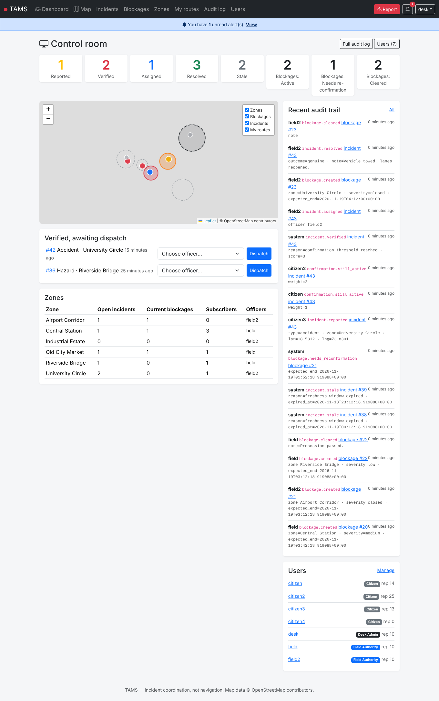
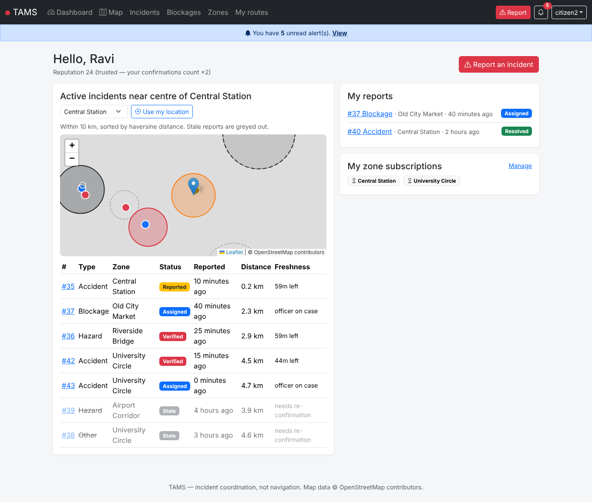
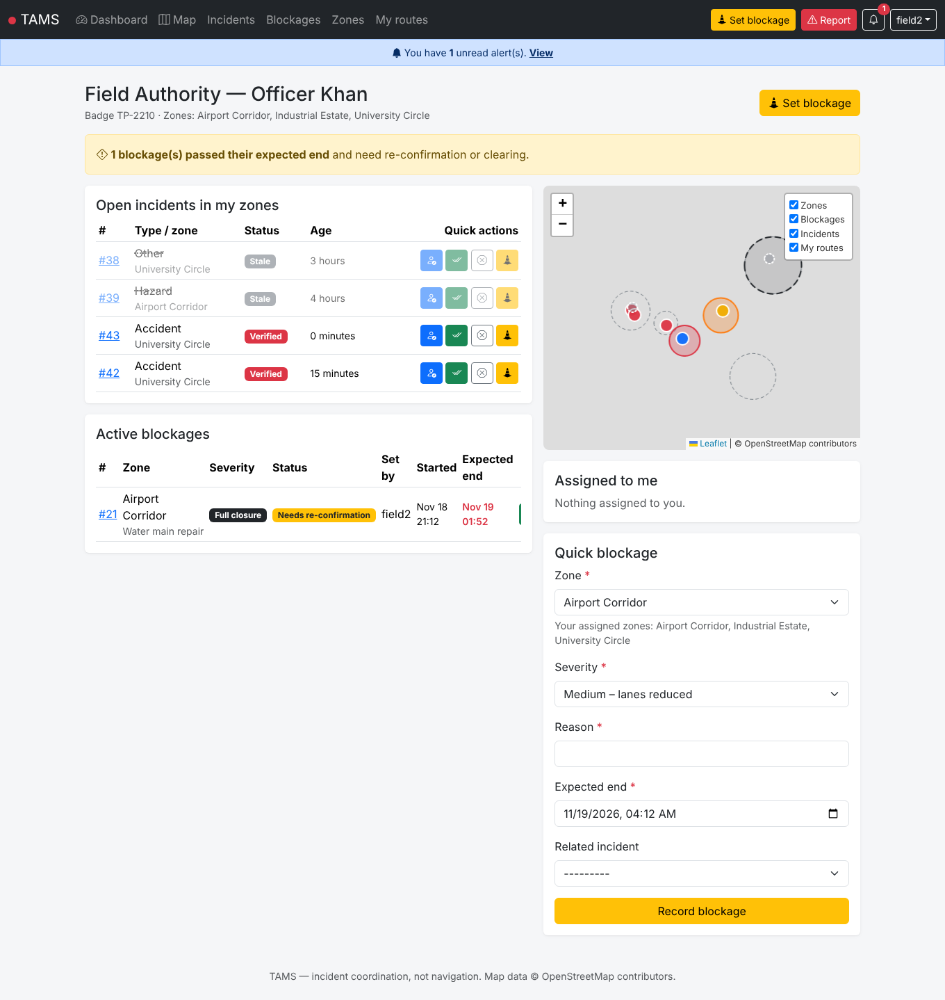
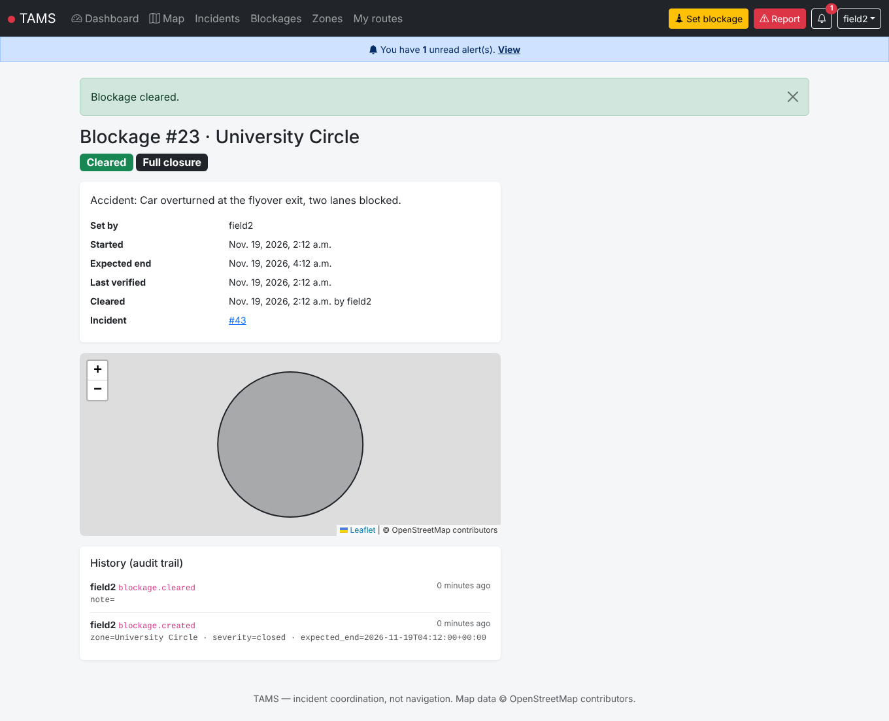
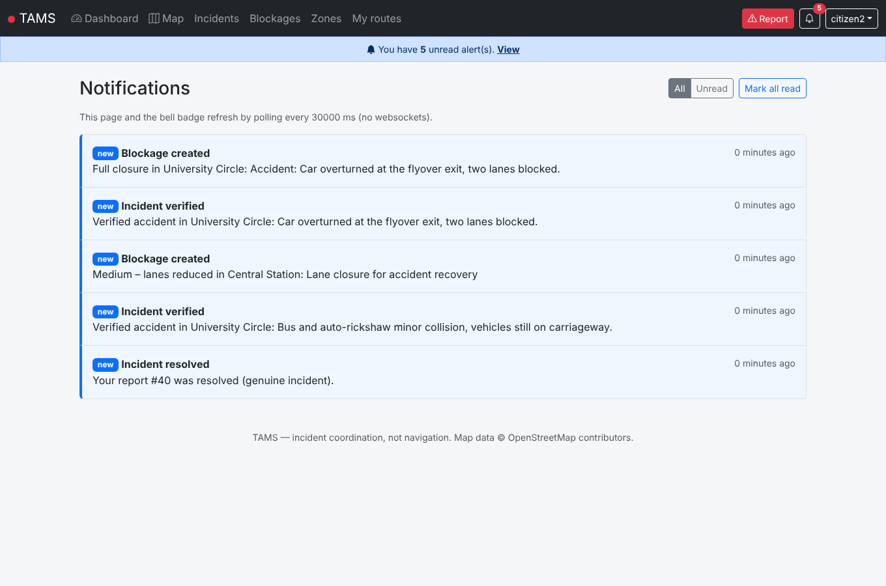
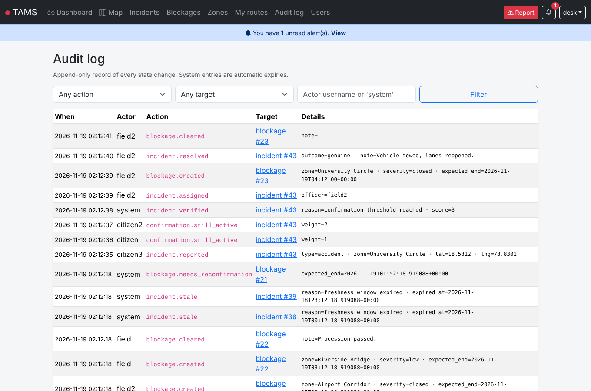
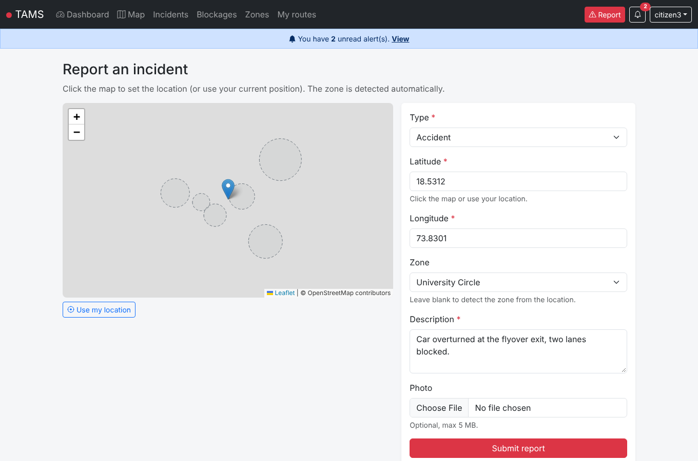
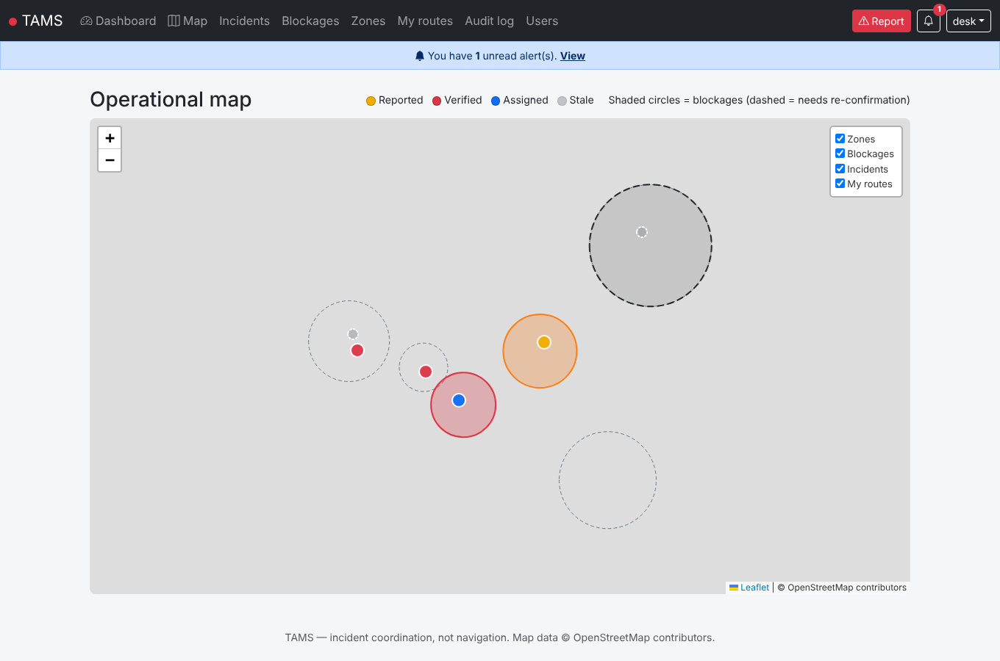

# TAMS — Traffic & Accident Management System

A Django web app for **coordinating traffic incidents between citizens and road authorities**:
- structured incident reporting;
- community re-verification, with freshness and expiry;
- authority case management;
- audited road blockages;
- geofenced zone alerts.

It is deliberately **not** a navigation app. See [NOTES.md](NOTES.md) for the design reasoning, research, non-goals and trade-offs.

**Stack:**
- Django 5.1 on Python 3.11+;
- SQLite in development (PostgreSQL recommended for production);
- Django templates with a little vanilla JS;
- Bootstrap 5 and Leaflet + OpenStreetMap, both from a CDN.

There is no build step, no API keys, and no GeoDjango.

---

## Quick start

```bash
git clone <this repo> tams && cd tams
```

```bash
python3 -m venv venv
```

```bash
source venv/bin/activate        # Windows: venv\Scripts\activate
```

```bash
pip install -r requirements.txt
```

```bash
cp .env.example .env            # optional — every setting has a dev default
```

```bash
python manage.py migrate
```

```bash
python manage.py seed           # demo data; use `seed --flush` to reset
```

```bash
python manage.py runserver
```

Open <http://127.0.0.1:8000/>. Django admin is at <http://127.0.0.1:8000/admin/> (log in as `desk`).

Run the checks and tests:

```bash
python manage.py check
```

```bash
python manage.py test
```

In production, schedule the expiry sweep (it also runs lazily on web requests, at most once a minute):

```bash
python manage.py expire_stale
```

### Demo credentials

All seeded users share the password **`demo12345`**.

| Username | Role | Notes |
|---|---|---|
| `citizen` | Citizen | Rep 12. Subscribed to Central Station and Riverside Bridge. Has a saved route "Home → Office". |
| `citizen2` | Citizen | Rep 22, trusted: confirmations count ×2. Subscribed to Central Station and University Circle. |
| `citizen3` | Citizen | Rep 10. Subscribed to Old City Market. |
| `citizen4` | Citizen | Rep 3 after a false report: confirmations count ×0. |
| `field` | Field Authority | Zones: Central Station, Old City Market, Riverside Bridge. |
| `field2` | Field Authority | Zones: University Circle, Airport Corridor, Industrial Estate. |
| `desk` | Desk Admin | Control room. Also a Django superuser for `/admin/`. |

The seed data includes incidents in every status (reported, verified, assigned, resolved genuine and false, and two stale ones). It also includes one active blockage, one blockage needing re-confirmation, one cleared blockage, confirmations, notifications and a full audit trail.

---

## Feature tour

### Roles
There is a custom `core.User` model (`AbstractUser` plus `role`, `reputation_score`, `assigned_zones`, `badge_number`), present from the first migration.
- **Public sign-up only ever creates Citizens.**
- A Desk Admin grants the other roles, and every change is written to the audit log.
- Every page is role-gated: an anonymous visitor goes to the login page, and the wrong role gets a 403.

### Citizen
- **Report an incident** (`/incidents/report/`).
  - Click the map or use your current location; the zone is detected automatically.
  - Choose the type (accident / blockage / hazard / other), write a description and optionally attach a photo.
- **Confirm other reports** with typed votes: *Still active* or *Cleared*.
  - Each user can cast each kind once per incident.
  - Votes are weighted by reputation.
  - Once the weighted score reaches 3 (configurable), the incident becomes **verified** and the zone's subscribers are alerted.
- **Freshness.** A report stays fresh for 60 minutes (configurable). Each *Still active* vote extends it. When nobody re-confirms, it becomes **stale**: greyed out and struck through in lists, and shown as a translucent dashed marker on the map. A single new confirmation revives it. Enough *Cleared* votes mark it stale early.
- **Dashboard.** Shows your reports, your subscriptions, and active incidents nearby. "Nearby" uses haversine distance from your browser location, falling back to a zone you choose.
- **Zone subscriptions** (`/zones/`): one-click subscribe or unsubscribe.
- **My routes** (stretch feature): draw your usual route on the map. If a current blockage lies on it, you get a "Your usual route is blocked" banner and a notification.

### Field Authority
- **Dashboard.** Shows open incidents in your zones, with quick actions: *assign to me*, *resolve (genuine)*, *dismiss as false report* and *set blockage*. Also shows active blockages, a "needs re-confirmation" warning, the operational map and a quick-blockage form.
- **Blockages** are audited records with zone, reason, severity, start, expected end, set-by, cleared-by and status.
  - **Extend / re-confirm** moves a blockage back to `active` with a new end time.
  - **Clear** is a state transition: the record and its history are kept.
  - When the expected end passes, the blockage auto-flips to **needs re-confirmation**, and the officer and the zone's officers are notified.
- **Resolve** an incident with an outcome. Reputation is then settled: matching voters gain, mismatching voters lose, and false reporters lose 3.

### Desk Admin (control room)
- Counts by incident status and blockage status.
- The operational map.
- The **verified, awaiting dispatch** queue, with a dispatch-to-officer action (the officer is notified).
- Per-zone load: open incidents, blockages, subscribers and officers.
- The recent audit trail.
- **Full audit log** (`/control-room/audit/`), filterable by action, actor (including `system`) and target.
- **User management** (`/control-room/users/`): change roles, assign zones, edit reputation, deactivate accounts. Every change is audited.
- **Django admin** is registered for every model, with list displays, filters, search and inlines. AuditLog is read-only there.

### Notifications
- Notifications are created when, in a subscribed zone:
  - an incident is verified;
  - a blockage is created, extended or cleared.
- They are also created for dispatch, for resolution of your own report, for blockages needing re-confirmation, and for blocked saved routes.
- **Delivery is by polling.** `base.html` polls `/api/notifications/` every 30 s and updates the bell badge, the unread banner and the page title, and shows a toast for each new alert. There are no WebSockets (see NOTES.md §3).
- `/notifications/` lists all alerts with read/unread state, an unread filter and a "mark all read" button. Opening an alert marks it read.

### Map
`/map/` uses Leaflet + OpenStreetMap:
- **Incidents** are markers coloured by status: amber = reported, red = verified, blue = assigned, grey and dashed = stale.
- **Blockages** are shaded circles over their zone, coloured by severity and dashed when they need re-confirmation.
- **Zone outlines** and **your saved routes** can be toggled as layers.

---

## Screenshots

These were captured by an automated end-to-end run, saved in [`docs/screenshots/`](docs/screenshots/). The sandbox they were taken in had no access to OSM tile servers, so the map base layer is blank grey; on a normal machine the OSM street map appears under the markers.

| | |
|---|---|
| Control room  | Citizen dashboard  |
| Field Authority dashboard  | Blockage detail + audit history  |
| Notifications  | Audit log  |
| Report incident  | Operational map  |

_Placeholder: add screenshots with live map tiles here before submission if desired._

---

## Project layout

```
config/                 settings (env-driven), urls, wsgi/asgi
core/
  models.py             User, Zone, Incident, Confirmation, Blockage, Subscription,
                        Notification, AuditLog, SavedRoute (+ state machines)
  services.py           all state changes: audit + notifications + reputation + expiry
  geo.py                haversine, bounding box, point-to-polyline distance
  views.py / urls.py    role-gated views + JSON endpoints (/api/notifications/, /api/map-data/)
  forms.py              validated ModelForms / Forms (Bootstrap-styled)
  admin.py              admin for every model
  middleware.py         lazy expiry sweep (≤ once/min)
  management/commands/  seed, expire_stale
  templates/core/       page templates
  tests/                model, confirmation/reputation and view tests (42 tests)
templates/              base layout, auth pages, 403/404
static/                 tams.css, tams.js (polling + Leaflet helpers)
```

## Configuration

| Env var | Default | Meaning |
|---|---|---|
| `DJANGO_SECRET_KEY` | dev key | **Set this in production.** |
| `DJANGO_DEBUG` | `True` | |
| `DJANGO_ALLOWED_HOSTS` | `localhost,127.0.0.1,testserver` | |
| `TAMS_INCIDENT_FRESHNESS_MINUTES` | `60` | Freshness window. |
| `TAMS_VERIFICATION_THRESHOLD` | `3` | Weighted score needed to verify. |
| `TAMS_CLEARED_THRESHOLD` | `3` | Weighted "cleared" score that marks an incident stale early. |
| `TAMS_NOTIFICATION_POLL_MS` | `30000` | Frontend poll interval. |
| `TAMS_ROUTE_BUFFER_M` | `300` | Distance at which a blockage counts as on a saved route. |
| `TAMS_NEARBY_RADIUS_KM` | `10` | Radius of "nearby" on the citizen dashboard. |

See `.env.example` for the full list.
