# PROJECT REPORT

## Traffic & Accident Management System (TAMS)
### A Django-based platform for coordinating road incidents between citizens and authorities

| | |
|---|---|
| **Submitted by** | _[Student Name(s)] — [Roll No.]_ |
| **Course** | _[Course / Semester]_ — Web Development with Django |
| **Under the guidance of** | _[Guide Name, Designation]_ |
| **Department / Institute** | _[Department], [College / University]_ |
| **Academic Year** | _[2025–26]_ |
| **Source code** | https://github.com/ri5u/traffic_accident_management |

---

## Certificate

_This is to certify that the project entitled **"Traffic & Accident Management System"** is a bonafide work carried out by **[Student Name]** in partial fulfilment of the requirements of **[Course]** during the academic year **[2025–26]**._

&nbsp;

_Guide: ____________________ &nbsp;&nbsp;&nbsp;&nbsp; Head of Department: _____________________

## Acknowledgement

_I would like to express my sincere gratitude to my guide **[Guide Name]** for their valuable guidance and encouragement throughout this project. I also thank the Head of Department and all faculty members of **[Department]** for providing the facilities and support needed to complete this work._

---

## Table of Contents
1. [Abstract](#1-abstract)
2. [Introduction](#2-introduction)
3. [Problem Statement and Objectives](#3-problem-statement-and-objectives)
4. [Literature Survey / Existing Systems](#4-literature-survey--existing-systems)
5. [Requirement Analysis](#5-requirement-analysis)
6. [System Design](#6-system-design)
7. [Database Design](#7-database-design)
8. [Implementation](#8-implementation)
9. [Mapping to the Django Syllabus](#9-mapping-to-the-django-syllabus)
10. [Testing](#10-testing)
11. [Results and Screenshots](#11-results-and-screenshots)
12. [Limitations and Future Scope](#12-limitations-and-future-scope)
13. [Conclusion](#13-conclusion)
14. [References](#14-references)
15. [Appendix A — Installation Guide](#appendix-a--installation-guide)
16. [Appendix B — Demo Credentials](#appendix-b--demo-credentials)

---

## 1. Abstract

Road accidents, breakdowns and closures are reported every day, but the information is scattered. Citizens post on social media or call helplines, consumer navigation apps show anonymous "traffic", and authorities track cases in phone logs or spreadsheets. Nobody can tell whether a report is still true, who is handling it, or when the road will reopen.

The **Traffic & Accident Management System (TAMS)** is a web application, built with the **Django** framework, that provides this missing **coordination layer**.

- **Citizens** report incidents (accident, blockage, hazard or other) with a map location, a description and an optional photo. Other citizens **re-confirm** them with typed votes, "still active" or "cleared", which are weighted by a reputation score. A report becomes *verified* once enough weighted confirmations arrive. If nobody re-confirms it within a **freshness window**, it automatically becomes *stale*.
- **Field Authority** officers take ownership of incidents, resolve them, and record **road blockages** as audited records with a severity, a reason and an expected end time. A blockage that runs past its expected end is automatically flagged for **re-confirmation**.
- A **Desk Admin** (control room) gets a live dashboard with counts by status, an operational map, a dispatch queue, user management and a complete, tamper-proof **audit log**.
- Users subscribe to **zones** and receive in-app **notifications**, delivered by lightweight polling.

The system is implemented in Django 5.1 with SQLite (PostgreSQL-ready), Django templates, Bootstrap 5 and Leaflet/OpenStreetMap maps. It is organised into 8 functional modules, has **37 URL routes**, and is verified by **54 automated tests**.

**Keywords:** Django, MVT, traffic incident management, crowdsourcing, verification, audit trail, geofencing, role-based access control.

---

## 2. Introduction

### 2.1 Background
Traffic Incident Management (TIM) is the coordinated process of detecting, verifying, responding to and clearing road incidents so that traffic returns to normal as quickly and safely as possible. The U.S. Federal Highway Administration (FHWA) describes the TIM timeline as **detection → verification → response → clearance → recovery**. Each stage has its own actors and timestamps.

Today, two kinds of tools exist:
1. **Consumer navigation apps** (Google Maps, Waze). They collect crowd reports and show them on a map, but they are built for *routing drivers*, not *managing incidents*. There is no case ownership, no official closure record and no audit trail.
2. **Professional traffic-management centre software.** It is expensive, proprietary, and usually has no channel for citizens.

TAMS sits between the two. It is a lightweight, open, web-based **management system** that gives citizens a structured way to report incidents and gives authorities a workflow to verify, own and close them.

### 2.2 Motivation
- Unverified or out-of-date reports cause confusion, for example a "road closed" post that is still being shared hours after the road reopened.
- Authorities need **accountability**: who closed a road, why, until when, and who reopened it.
- Citizens want **relevant alerts** for the areas they care about, not a firehose of data.

### 2.3 Scope
**In scope:**
- citizen reporting and confirmations;
- the incident lifecycle;
- audited blockages;
- zone subscriptions and notifications;
- role-based dashboards and an operational map;
- an audit log;
- Django admin;
- a saved-route ("trip intent") alert.

**Out of scope (explicit non-goals):**
- turn-by-turn navigation and route prediction;
- live third-party traffic feeds;
- native mobile apps (the web app is responsive instead);
- background location tracking;
- WebSockets;
- machine learning or image analysis.

---

## 3. Problem Statement and Objectives

### 3.1 Problem Statement
> To design and develop a web-based system that lets citizens report road incidents in a structured way, lets the community keep those reports accurate over time, and lets road authorities verify, own, resolve and audit incidents and road closures, with relevant alerts delivered to subscribed users.

### 3.2 Objectives
1. Build a **custom user model** with three roles (Citizen, Field Authority, Desk Admin) and enforce **role-based access control** on every page and action.
2. Implement an **incident lifecycle** (`reported → verified → assigned → resolved`, plus `stale`) as an explicit state machine.
3. Implement **crowdsourced verification** with typed confirmations, a configurable threshold, and **reputation-weighted** votes.
4. Implement a **freshness/expiry** mechanism, so unconfirmed reports become stale automatically.
5. Model **road blockages** as audited records with create, extend, re-confirm and clear actions; clearing must never delete history.
6. Provide **geofenced notifications** for zone subscribers.
7. Provide **role-specific dashboards** and an interactive **map**.
8. Record every state change in an **audit log**.
9. Apply Django best practices: forms with validation, CSRF protection, the ORM with proper relationships, migrations, admin, sessions and cookies, groups and permissions, and automated tests.

---

## 4. Literature Survey / Existing Systems

| System | What it does well | Gap that TAMS addresses |
|---|---|---|
| **Waze / Google Maps** | Large-scale crowd reports with "Still there? / Not there" prompts; reports expire over time | Built for routing; no case ownership, official closure records or audit trail; authorities are just other users |
| **311 citizen-service portals** | Structured citizen requests and ticket tracking | Not real-time; no community verification; not focused on traffic |
| **Traffic Management Centre / CAD software** | Dispatch, operator consoles, integration with sensors | Proprietary and expensive; no citizen input; heavy infrastructure |
| **Social media / helplines** | Fast and familiar | Unstructured, unverifiable, no lifecycle, information goes stale |

**Key findings that shaped the design:**
- **FHWA TIM guidelines** separate *detection* from *verification*. A citizen report is only detection, so TAMS requires community or authority verification. The lifecycle stages map to the TIM timeline, and each has its own timestamp (`created_at`, `verified_at`, `assigned_at`, `resolved_at`).
- **Waze's staleness handling.** Reports stay visible for a period that depends on how many users react, and "Not there" votes shorten it. Users complain about reports that vanish too early and about single "troll" votes. So TAMS uses a freshness window that confirmations extend, requires a *weighted threshold* before "cleared" votes can expire a report, and weights votes by reputation.
- **Municipal operations tools** separate the public reporter, the field responder and the dispatcher, and treat road closures as permit-like records with an accountable officer. This led to the three roles and the audited `Blockage` model.

---

## 5. Requirement Analysis

### 5.1 Users and Roles

| Role | Description | Main capabilities |
|---|---|---|
| **Citizen** | A member of the public (self sign-up) | Report incidents, confirm or deny reports, subscribe to zones, save routes, receive alerts |
| **Field Authority** | An on-ground officer (granted by an admin) | Take ownership of incidents, verify, resolve (genuine or false report), create, extend and clear blockages |
| **Desk Admin** | A control-room operator | View city-wide counts and the map, dispatch incidents to officers, manage users and roles, view and export the audit log, use Django admin |

### 5.2 Functional Requirements

| ID | Requirement |
|---|---|
| FR1 | Users can sign up (always as Citizen), log in and log out. |
| FR2 | A citizen can report an incident with type, location (map click or GPS), zone (auto-detected), description and optional photo. |
| FR3 | Other users can confirm an incident as *still active* or *cleared*, once per kind; reporters cannot confirm their own report. |
| FR4 | An incident is auto-verified when the reputation-weighted *still active* score reaches the threshold (default 3). |
| FR5 | An incident not re-confirmed within the freshness window (default 60 minutes) becomes *stale*; a new confirmation revives it. |
| FR6 | Field Authorities can verify, assign to themselves, and resolve with an outcome (genuine or false report). |
| FR7 | Desk Admins can dispatch a verified incident to any officer. |
| FR8 | Field Authorities can create, extend (re-confirm) and clear blockages; clearing keeps the record. |
| FR9 | A blockage past its expected end becomes *needs re-confirmation*, and the responsible officers are notified. |
| FR10 | Users can subscribe and unsubscribe to zones; subscribers are notified when incidents are verified or blockages change in that zone. |
| FR11 | A notification centre shows read/unread alerts; the unread count updates automatically every 30 seconds. |
| FR12 | Role-specific dashboards and an interactive map show incidents (coloured by status) and blockages (shaded zones). |
| FR13 | Every state change is recorded in an audit log, which Desk Admins can filter and export to CSV. |
| FR14 | Reputation is updated when an incident is resolved: correct confirmers and reporters gain, incorrect ones lose. |
| FR15 | (Stretch) Users can save a usual route and are alerted when a blockage lies on it. |
| FR16 | A monthly incident archive is available at `/incidents/archive/YYYY/MM/`. |

### 5.3 Non-Functional Requirements

| Category | Requirement |
|---|---|
| Security | CSRF protection, hashed passwords, role and permission checks in both views and services, POST-only state changes, XSS auto-escaping, secrets in environment variables |
| Usability | Responsive design (desktop and mobile), clear status colours, one-click demo accounts |
| Reliability | State changes are atomic (database transactions); illegal transitions are rejected |
| Maintainability | Business logic centralised in a services layer; 54 automated tests; documented design decisions (`NOTES.md`) |
| Portability | No GIS extensions needed; SQLite by default, PostgreSQL by configuration |
| Performance | Indexed queries for expiry and notifications; bounding-box pre-filter before distance calculation; `select_related`/`prefetch_related` to avoid N+1 queries |

### 5.4 Hardware and Software Requirements

| Type | Requirement |
|---|---|
| Hardware | Any PC with 4 GB RAM or more; browser with JavaScript enabled |
| OS | Windows / Linux / macOS |
| Language | Python 3.11+ |
| Framework | Django 5.1 |
| Database | SQLite 3 (development); PostgreSQL 14+ (recommended for production) |
| Front-end | Django Template Language, Bootstrap 5.3, Bootstrap Icons, Leaflet 1.9 with OpenStreetMap tiles, vanilla JavaScript |
| Libraries | Pillow (image upload), python-dotenv (environment config) |
| Tools | VS Code / PyCharm, Git and GitHub, Chrome / Firefox |

---

## 6. System Design

### 6.1 Architecture (Django MVT + services layer)

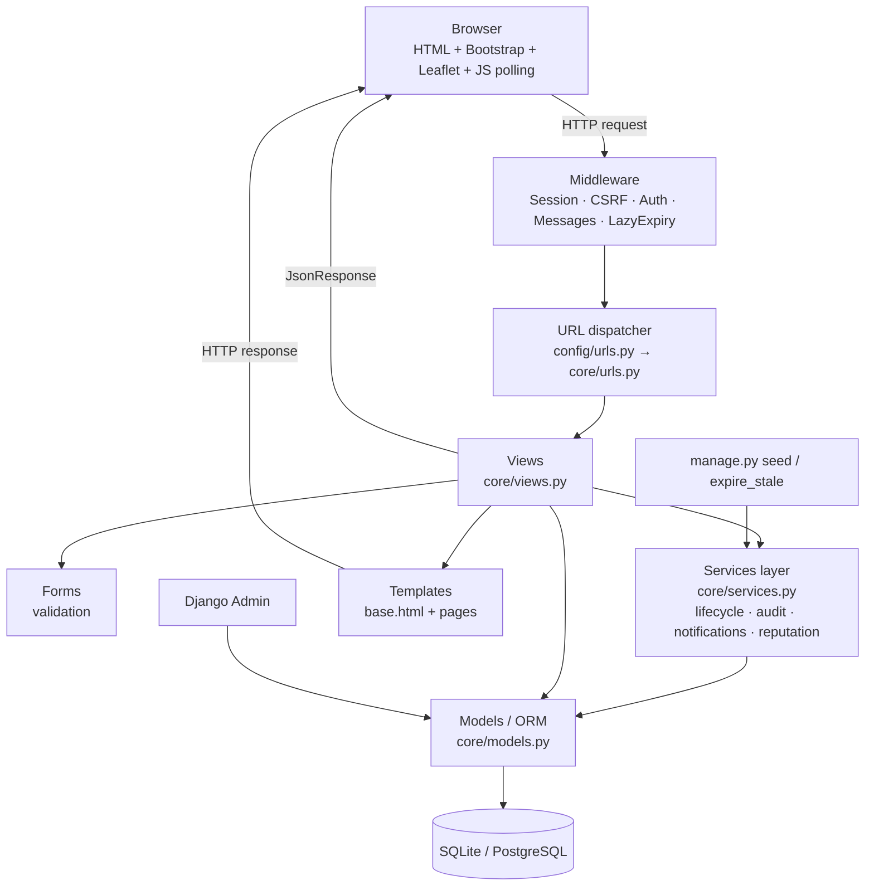

The views stay **thin**. Every action that changes state goes through `core/services.py`, which:
1. checks permissions again;
2. performs the transition inside a database transaction;
3. writes an `AuditLog` row;
4. creates notifications;
5. updates reputation.

Because of this, no view can forget a side effect, and the business rules can be tested without HTTP.

### 6.2 Use Case Diagram

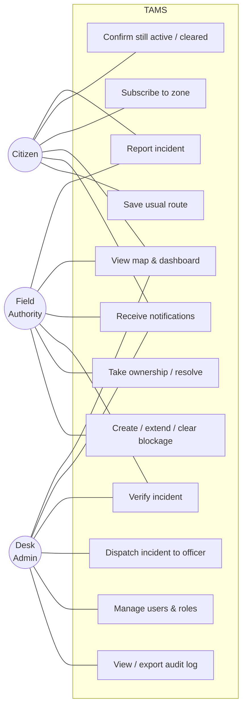

### 6.3 Incident Lifecycle (State Diagram)

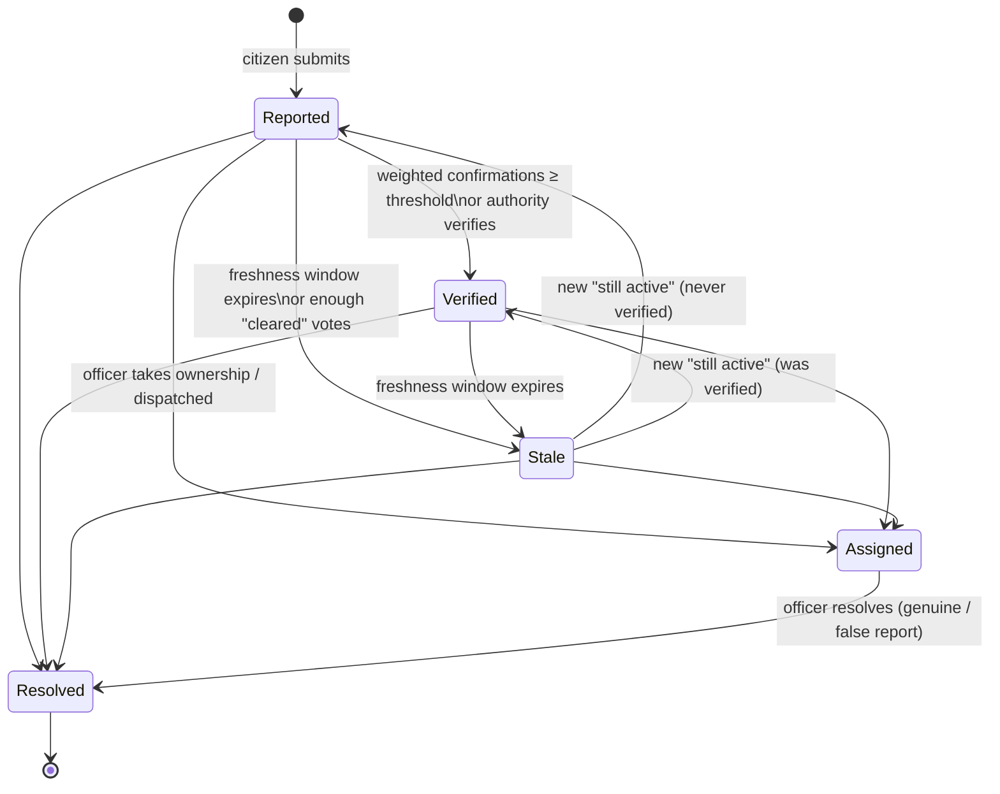

### 6.4 Blockage Lifecycle (State Diagram)

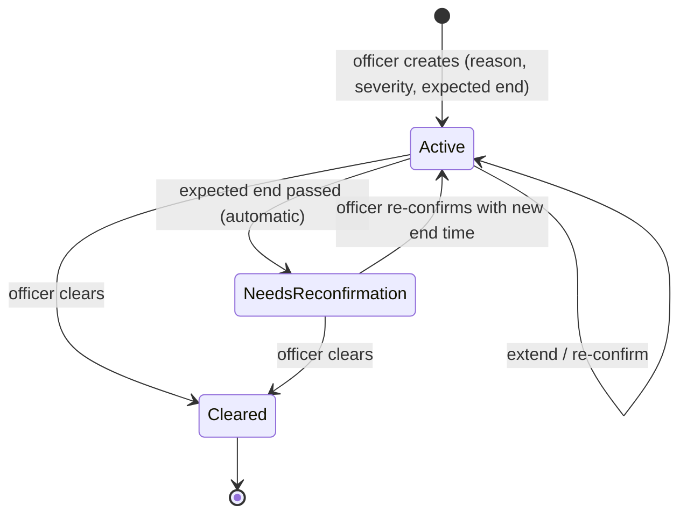

### 6.5 Data Flow Diagram — Level 0 (Context)

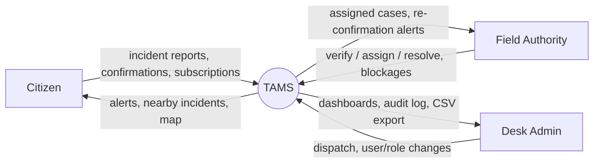

### 6.6 Data Flow Diagram — Level 1

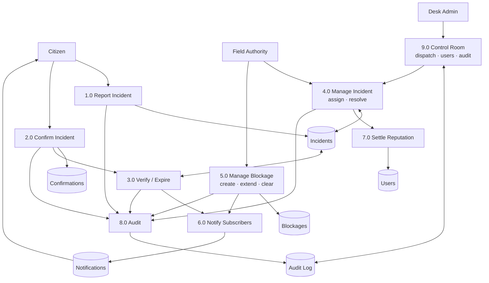

### 6.7 Sequence Diagram — Report → Verify → Notify

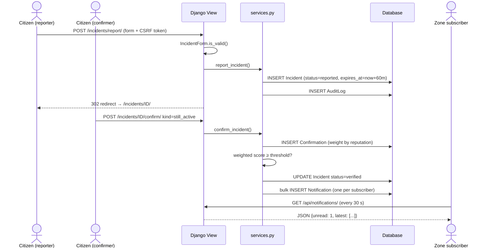

### 6.8 Module Description

| Module | Description | Key files |
|---|---|---|
| **Authentication & Users** | Custom user model with roles and reputation; sign-up, login, logout; role groups and permissions | `core/models.py` (User), `core/roles.py`, `core/forms.py` (SignUpForm), `templates/registration/` |
| **Incident Management** | Report, list and filter, detail, confirm, verify, assign, resolve, monthly archive | `core/views.py`, `core/services.py`, `core/templates/core/incident_*.html` |
| **Verification & Reputation** | Typed confirmations, weighted threshold, freshness/stale, reputation settlement | `core/services.py` (`confirm_incident`, `settle_reputation`, `expire_stale`) |
| **Blockage Management** | Create, extend, re-confirm, clear; auto re-confirmation flag | `core/services.py`, `core/templates/core/blockage_*.html` |
| **Zones & Notifications** | Subscriptions, notification fan-out, polling API, notification centre | `core/views.py` (`api_notifications`), `static/js/tams.js` |
| **Dashboards & Map** | Citizen, Field Authority and Control-room dashboards; Leaflet map with a JSON data API | `core/views.py`, `core/templates/core/dashboard_*.html`, `map.html` |
| **Audit & Administration** | Audit log page and CSV export, in-app user management, Django admin | `core/views.py`, `core/admin.py` |
| **Trip-intent (stretch)** | Saved routes; alert when a blockage lies on a route | `core/models.py` (SavedRoute), `core/geo.py` |

---

## 7. Database Design

### 7.1 Entity–Relationship Diagram

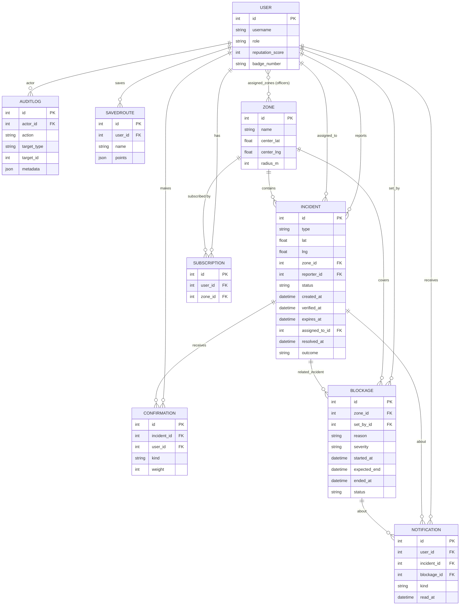

### 7.2 Data Dictionary

**User** (`core_user`, extends Django's `AbstractUser`)

| Field | Type | Constraints | Description |
|---|---|---|---|
| id | BigAutoField | PK | |
| username, password, email, first_name, last_name, is_active, is_staff, is_superuser, date_joined, last_login | inherited | | Standard Django auth fields; the password is stored hashed |
| role | CharField(20) | choices: citizen / field_authority / desk_admin; indexed | Drives access control |
| reputation_score | IntegerField | default 10 | Weights confirmations |
| badge_number | CharField(30) | blank | Officer badge |
| assigned_zones | ManyToMany → Zone | | Zones an officer is responsible for |

**Zone**

| Field | Type | Constraints | Description |
|---|---|---|---|
| name | CharField(100) | unique | e.g. "Central Station" |
| description | CharField(255) | blank | |
| center_lat / center_lng | FloatField | −90..90 / −180..180 validators | Circle centre |
| radius_m | PositiveIntegerField | ≥ 50 | Circle radius in metres |

**Incident**

| Field | Type | Constraints | Description |
|---|---|---|---|
| type | CharField | accident / blockage / hazard / other | |
| lat, lng | FloatField | range validators | Location |
| zone | FK → Zone | PROTECT | Auto-detected from the location |
| description | TextField | ≥ 10 characters (form) | |
| photo | ImageField | optional, ≤ 5 MB | Upload path `incidents/YYYY/MM/` |
| reporter | FK → User | PROTECT | |
| status | CharField | reported / verified / assigned / resolved / stale; indexed | |
| created_at, verified_at, assigned_at, resolved_at | DateTimeField | | Lifecycle timestamps (TIM timeline) |
| last_confirmed_at, expires_at | DateTimeField | expires_at indexed | Freshness |
| assigned_to, resolved_by | FK → User | SET_NULL | |
| outcome | CharField | genuine / false_report | Ground truth for reputation |
| resolution_note | TextField | blank | |
| reputation_settled | BooleanField | default False | Makes settlement idempotent |

**Confirmation**: incident (FK, CASCADE), user (FK, CASCADE), kind (still_active / cleared), weight (a snapshot of the user's weight), created_at. **Unique:** (incident, user, kind).

**Blockage**: zone (FK, PROTECT), set_by (FK, PROTECT), related_incident (FK, SET_NULL), reason, severity (low / medium / high / closed), started_at, expected_end, ended_at, last_verified_at, cleared_by (FK, SET_NULL), status (active / needs_reconfirmation / cleared).

**Subscription**: user (FK), zone (FK), created_at. **Unique:** (user, zone).

**Notification**: user (FK), incident (FK, nullable), blockage (FK, nullable), kind (8 types), message, created_at, read_at (NULL means unread). Index on (user, read_at).

**AuditLog**: actor (FK, nullable; NULL means system), action (e.g. `incident.verified`), target_type, target_id, metadata (JSON), created_at. Append-only.

**SavedRoute**: user (FK), name (unique per user), points (JSON list of [lat, lng] pairs), notify (bool).

### 7.3 Normalisation and Integrity
- The tables are in **3NF**. Zone data is not repeated on incidents (they use an FK), and users are referenced by FK everywhere.
- **Referential integrity:**
  - `PROTECT` stops a zone or reporter from being deleted while incidents reference it, so history is never orphaned;
  - `CASCADE` removes dependent confirmations;
  - `SET_NULL` keeps audit rows when a user is deleted.
- **Uniqueness constraints** are enforced at the database level (`unique_together`). Duplicate votes or subscriptions are impossible even under concurrent requests.

---

## 8. Implementation

### 8.1 Project Structure
```
config/                 settings (env-driven), root urls, wsgi/asgi
core/                   the single Django app
  models.py             9 models + state machines            (504 lines)
  services.py           business logic                       (401 lines)
  views.py              37 function views + 1 class-based view (684 lines)
  forms.py              10 forms with validation             (191 lines)
  admin.py              admin for every model                (121 lines)
  urls.py               37 routes (path + re_path)
  roles.py              role → group → permission mapping
  geo.py                haversine & route distance
  middleware.py         lazy expiry middleware
  context_processors.py unread count on every page
  templatetags/         custom filters & tags
  management/commands/  seed, expire_stale
  tests/                54 tests                              (583 lines)
templates/ + core/templates/core/   32 templates (DTL + inheritance)
static/                 tams.css, tams.js (polling + Leaflet helpers)
```

### 8.2 Key Implementation Details

**(a) Custom user model and roles.** `User(AbstractUser)` adds `role`, `reputation_score`, `assigned_zones` and `badge_number`. It was defined *before the first migration*, as Django recommends. `AUTH_USER_MODEL = "core.User"`.

**(b) Role-based access control** works at three levels:
1. A custom decorator, `@role_required(*roles)`, sends anonymous users to the login page and returns **403** for the wrong role.
2. Django's permission system: role **Groups** (Citizens, Field Authorities, Desk Admins) are created automatically by a `post_migrate` signal. Users are synced into the right group on save, and `@permission_required("core.view_auditlog")` protects the CSV export.
3. The service functions check permissions again (defence in depth).

**(c) Incident state machine.** Each model defines a `TRANSITIONS` dictionary. `transition()` raises `InvalidTransition` for illegal moves; views catch it and show a friendly message.

**(d) Verification algorithm.**
```
weight(user) = 0 if reputation < 5
             = 2 if reputation ≥ 20 or user is an officer/admin
             = 1 otherwise
score = Σ weight over "still_active" confirmations
if status == reported and score ≥ THRESHOLD (3): status ← verified, notify zone subscribers
```
A "cleared" vote can mark an incident stale early only when the weighted cleared score is at least the threshold **and** greater than the "still active" score. This protects reports against single troll votes.

**(e) Freshness and expiry.**
- `expires_at = last confirmation + 60 min`.
- A sweep moves expired `reported`/`verified` incidents to `stale`, and overdue active blockages to `needs_reconfirmation`.
- The sweep runs from a **custom middleware**, at most once a minute (an atomic cache lock), and from `manage.py expire_stale` for cron.

**(f) Reputation settlement.** When an officer resolves an incident with an outcome:

| Party | Genuine | False report |
|---|---|---|
| Reporter | +2 | −3 |
| "Still active" confirmer | +1 | −1 |
| "Cleared" confirmer (voted before an officer took the case) | −1 | +1 |

Updates use `F()` expressions, which are atomic, and a `reputation_settled` flag guarantees they run only once.

**(g) Geofenced notifications.** When an incident is verified or a blockage changes, `notify_zone_subscribers()` creates one `Notification` per subscriber with a single `bulk_create`. The browser polls `/api/notifications/` every 30 seconds (paused while the tab is hidden) and updates the badge, the banner and the toasts. WebSockets were deliberately not used; see `NOTES.md`.

**(h) Distance calculation without GIS.** Coordinates are plain floats. Nearby search first applies an SQL **bounding box**, then the exact **haversine** distance:

`d = 2R · asin( √( sin²(Δφ/2) + cos φ₁ · cos φ₂ · sin²(Δλ/2) ) )`, where R = 6,371 km.

Saved-route checks use the point-to-segment distance in a local equirectangular projection.

**(i) Audit trail.** `services.audit()` records actor, action, target and JSON metadata for every change, and also writes it to the console log for debugging. The audit log is read-only in Django admin, filterable in the app, and exportable as CSV through a hand-built `HttpResponse`.

**(j) Sessions and cookies.**
- The citizen dashboard **remembers the selected zone in a cookie** (`tams_zone`, 30 days, `HttpOnly`, `SameSite=Lax`).
- **"Recently viewed" incidents** are kept in the **session**.
- Login state and flash messages also use the session.

**(k) Forms and validation.**
- ModelForms for Incident, Blockage, User and SavedRoute.
- Field-level checks: description length, photo size, expected end in the future.
- Form-level checks: zone auto-detection and the point must lie inside a zone.
- Model-level checks: lat/lng range validators.
- `` in every POST form, and Post/Redirect/Get after every successful submission.

**(l) Map.** Leaflet with OpenStreetMap tiles; no API key is needed.
- **Incidents** are circle markers coloured by status. Stale ones are translucent and dashed.
- **Blockages** are shaded circles over their zone, coloured by severity and dashed when they need re-confirmation.
- The data comes from the JSON endpoint `/api/map-data/`.
- `SECURE_REFERRER_POLICY` is set so the tile requests comply with OSM's usage policy.

**(m) User interface.** Django templates with inheritance (`base.html`), a dark sidebar app shell, Bootstrap 5 components, the Inter font, status pills and stat tiles. The layout is responsive and was checked at phone width (iPhone 13).

### 8.3 URL Map (main routes)

| URL | View | Access |
|---|---|---|
| `/` | home (landing) | public |
| `/accounts/login/`, `/accounts/logout/`, `/accounts/signup/` | LoginView, LogoutView, signup | public |
| `/dashboard/` | redirects by role | logged in |
| `/dashboard/citizen/`, `/dashboard/field/`, `/dashboard/control-room/` | role dashboards | Citizen / Field Authority / Desk Admin |
| `/incidents/`, `/incidents/report/`, `/incidents/<id>/` | list / create / detail | logged in |
| `/incidents/<id>/confirm/`, `verify/`, `assign/`, `resolve/` | actions (POST) | by role |
| `/incidents/archive/YYYY/MM/` | IncidentArchiveView (regex URL, CBV) | logged in |
| `/blockages/`, `/blockages/new/`, `/blockages/<id>/`, `extend/`, `clear/` | blockage management | officers act, all can view |
| `/zones/`, `/zones/<id>/subscribe/` | zones and subscriptions | logged in |
| `/notifications/`, `/api/notifications/` | notification centre and polling API | logged in |
| `/map/`, `/api/map-data/` | map page and JSON data | logged in |
| `/control-room/audit/`, `/control-room/audit/export.csv` | audit log and CSV | Desk Admin / `view_auditlog` permission |
| `/control-room/users/`, `/control-room/users/<id>/` | user management | Desk Admin |
| `/routes/`, `/routes/new/` | saved routes | logged in |
| `/admin/` | Django admin | staff |

---

## 9. Mapping to the Django Syllabus

| Unit | Topic | Where it is implemented |
|---|---|---|
| I | Projects vs apps, structure, `django-admin` and `manage.py` | `config/` project, `core/` app; custom commands `seed` and `expire_stale` |
| II | Views and URL mapping, URL params, regex URLs | `core/views.py`, `core/urls.py` (`<int:pk>`, `re_path` archive) |
| II | Requests and responses | `request.GET/POST/FILES/COOKIES/session`; `render`, `redirect`, `JsonResponse`, hand-built `HttpResponse` (CSV), `Http404` |
| II | Error handling | `get_object_or_404`, `PermissionDenied`, custom `handler404/403/500`, `InvalidTransition` handling |
| III | Templates, DTL, tags, variables, for/if, inheritance | `templates/base.html`, `core/templates/core/*`, ``, ``, `…` |
| III | Custom tags and filters, context processor | `core/templatetags/tams_tags.py`, `core/context_processors.py` |
| III | Debugging and testing | `DEBUG`, `LOGGING`, `manage.py check`, 54 `TestCase` tests |
| IV | Forms, GET/POST, CSRF, PRG, validation | `core/forms.py`, ``, `clean_*()` and `clean()`, redirect after POST |
| V | Models, migrations, ORM, foreign keys | `core/models.py`, `core/migrations/0001_initial.py`, `select_related`, `annotate`, `F()`, `bulk_create` |
| V | Django admin, groups, users, permissions | `core/admin.py`, `core/roles.py` (post_migrate groups), `@permission_required` |
| V | Database configuration | `config/settings.py` (SQLite default; PostgreSQL via `DB_ENGINE`) |
| VI | Cookies and sessions | `tams_zone` cookie; "recently viewed" session data |
| VI | Users, login/logout URLs, login in views | custom `User`, `LoginView`/`LogoutView`, `login()` after sign-up |

---

## 10. Testing

### 10.1 Strategy
- **Unit tests** cover the business rules in `services.py` and the models: lifecycle, freshness, reputation, blockage expiry.
- **Integration (view) tests** use Django's test client: the role access matrix, form validation, polling, cookies, sessions, regex URLs and error pages.
- **End-to-end manual and browser testing** covered the full demo flow: report → confirm → verify → notification → assign → blockage → resolve → clear → dispatch. It was run in a headless Chromium browser, with no JavaScript errors, on both desktop and mobile layouts.

Run all the tests with `python manage.py test`. The result is **54 tests, all passing**.

### 10.2 Test Cases

| ID | Test case | Input / action | Expected result | Result |
|---|---|---|---|---|
| TC01 | Full lifecycle | report → verify → assign → resolve | Status changes in order; audit rows written | Pass |
| TC02 | Resolved is terminal | verify a resolved incident | `InvalidTransition` raised | Pass |
| TC03 | Citizen cannot verify, assign or resolve | citizen calls the services | `PermissionDenied` | Pass |
| TC04 | Freshness expiry | no confirmations past `expires_at` | Status becomes stale; system audit row | Pass |
| TC05 | Revival | "still active" on a stale incident | Status back to reported; freshness extended | Pass |
| TC06 | Assigned never stale | expired assigned incident | Stays assigned | Pass |
| TC07 | Verification threshold | 3 normal-user confirmations | Verified on the 3rd, not before | Pass |
| TC08 | Trusted weight ×2 | trusted user (+2) and normal user (+1) | Verified | Pass |
| TC09 | Low-reputation weight ×0 | 5 low-reputation confirmations | Still reported, score 0 | Pass |
| TC10 | Duplicate vote | same user, same kind, twice | Second one ignored; unique constraint enforced in the database | Pass |
| TC11 | Self-confirmation | reporter confirms own report | Rejected | Pass |
| TC12 | "Cleared" votes | 3 cleared votes | Incident marked stale early | Pass |
| TC13 | Reputation — false report | resolve as false_report | Reporter −3, "still active" voters −1, "cleared" voters +1 | Pass |
| TC14 | Reputation — settled once | settle twice | No double counting | Pass |
| TC15 | Blockage auto-expiry | time passes `expected_end` | Status needs_reconfirmation; officer notified | Pass |
| TC16 | Extend re-confirms | extend a flagged blockage | Status active; new end time | Pass |
| TC17 | Clear keeps history | clear a blockage | Record still exists with status cleared and `ended_at` set | Pass |
| TC18 | Only officers create blockages | citizen POSTs the blockage form | 403; no record created | Pass |
| TC19 | Role access matrix | each role requests each dashboard | 200 / 403 / login redirect as designed | Pass |
| TC20 | Report outside zones | lat/lng far away | Form error "not inside any managed zone" | Pass |
| TC21 | Blockage end in the past | expected_end = 2000-01-01 | Form error | Pass |
| TC22 | Subscription and polling | subscribe, then a blockage is created | API unread = 1; opening the alert marks it read | Pass |
| TC23 | Notification privacy | open another user's notification | 404 | Pass |
| TC24 | Saved-route alert | blockage on a saved route | `route_blocked` notification and dashboard banner | Pass |
| TC25 | Groups and permissions | change role citizen → officer | Group switched; `has_perm` updated | Pass |
| TC26 | CSV export | Desk Admin (non-superuser) / Citizen | 200 `text/csv` attachment / 403 | Pass |
| TC27 | Cookie | choose a zone, revisit without a parameter | `tams_zone` cookie set and used | Pass |
| TC28 | Session | open 2 incidents | Session list `[latest, previous]` shown on dashboard | Pass |
| TC29 | Regex URL | `/incidents/archive/26/11/`, `/2026/13/` | 404 (regex), 404 (view validation) | Pass |
| TC30 | Custom 404 | unknown URL with `DEBUG=False` | Custom 404 page | Pass |
| TC31 | OSM tile policy | GET `/map/` | `Referrer-Policy: strict-origin-when-cross-origin` | Pass |

---

## 11. Results and Screenshots

All screens were captured from the running application with seeded demo data. On a machine with internet access, OpenStreetMap street tiles appear under the map markers.

**Landing page**
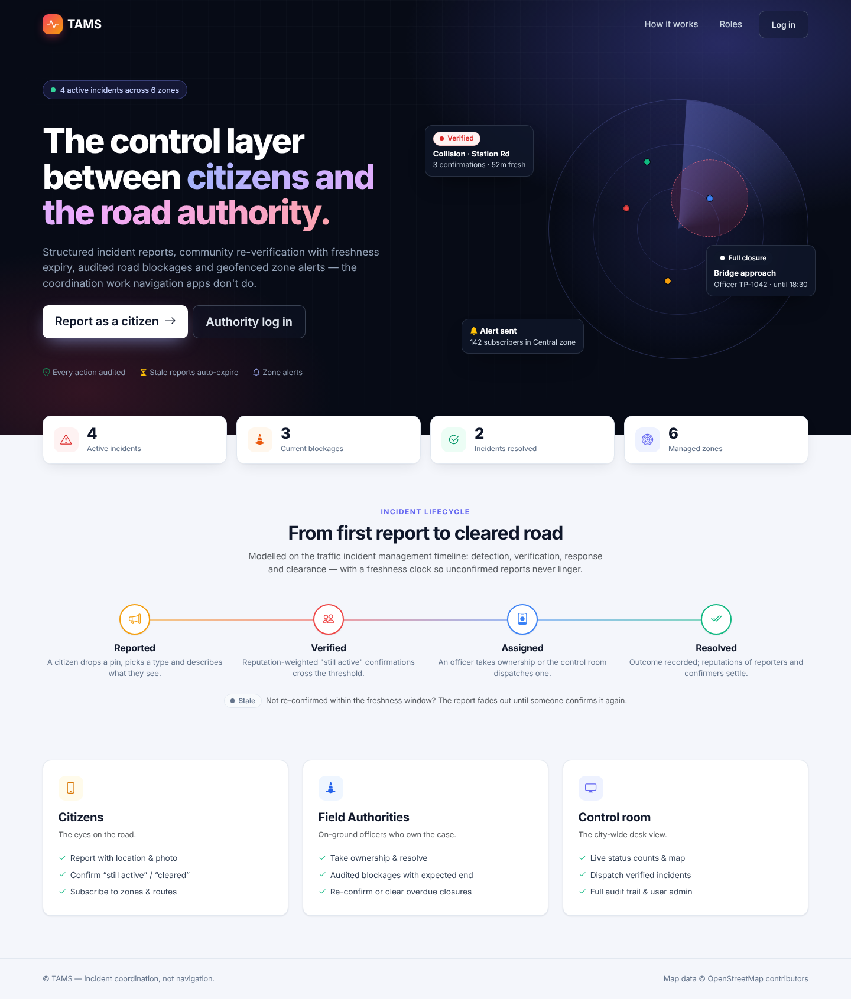

**Login with one-click demo accounts**
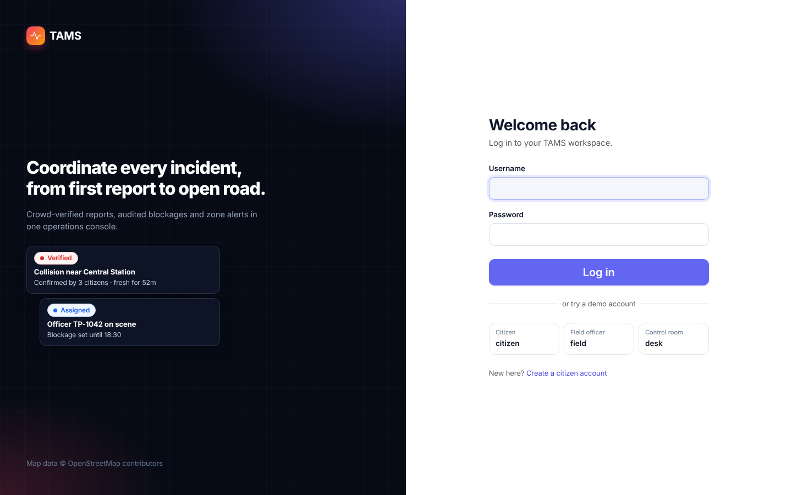

**Citizen dashboard** — reputation, nearby incidents sorted by distance, a blocked-route warning, stale reports greyed out
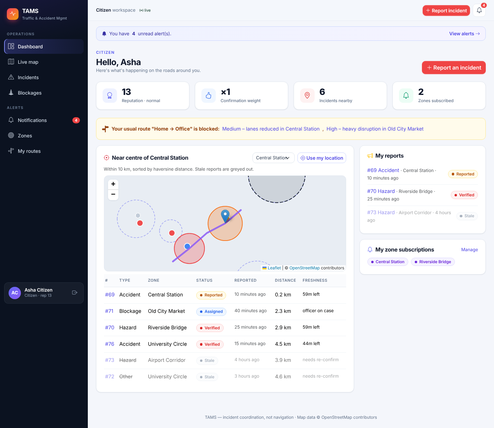

**Report incident** — click the map; the zone is detected automatically
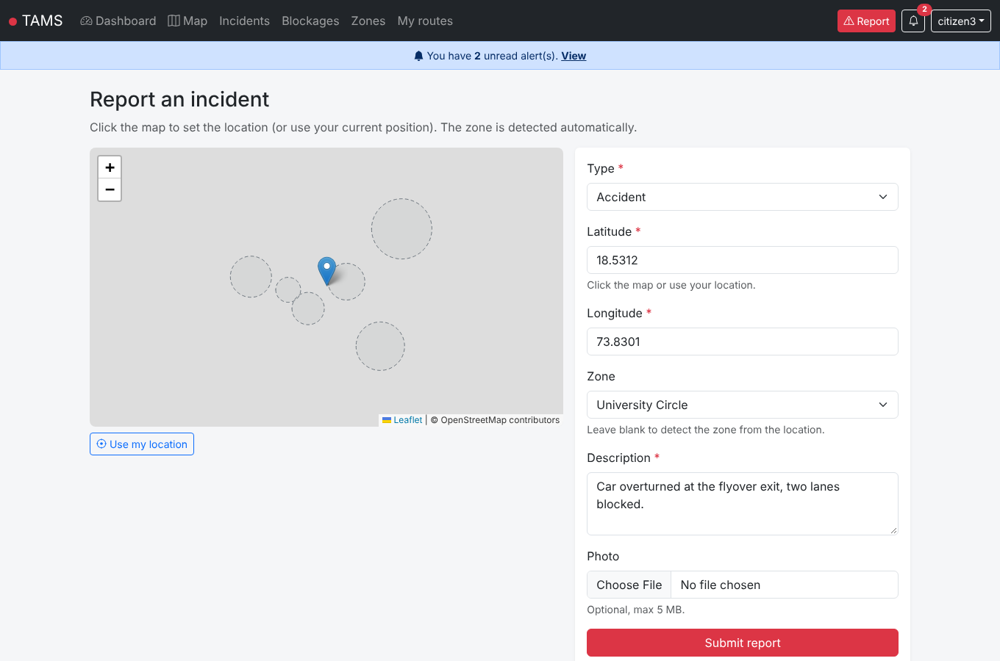

**Incident detail** — verification meter, confirmations, authority actions, audit history
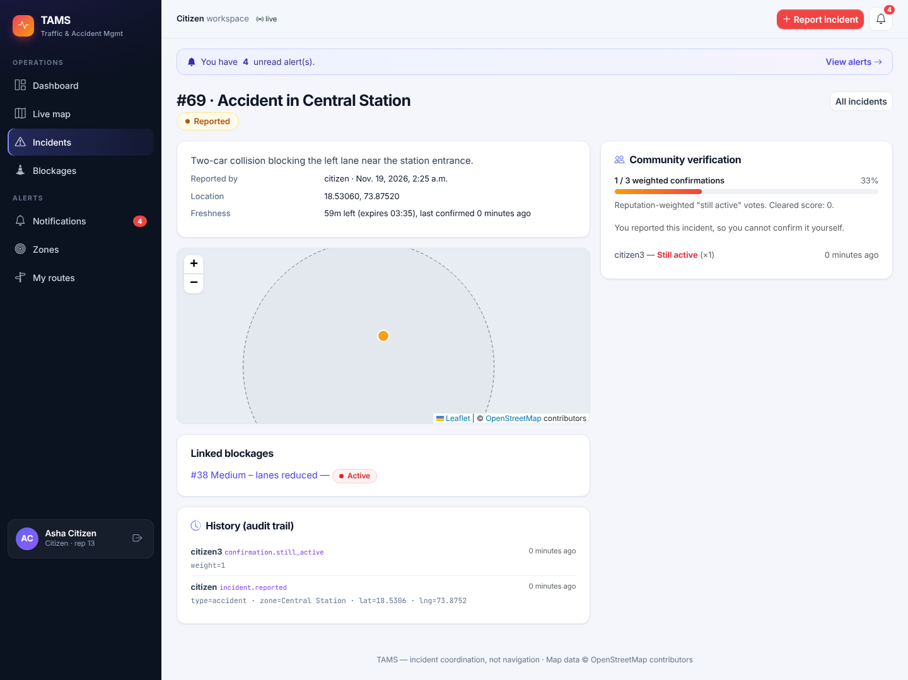

**Field Authority dashboard** — quick actions, active blockages, map, quick-blockage form
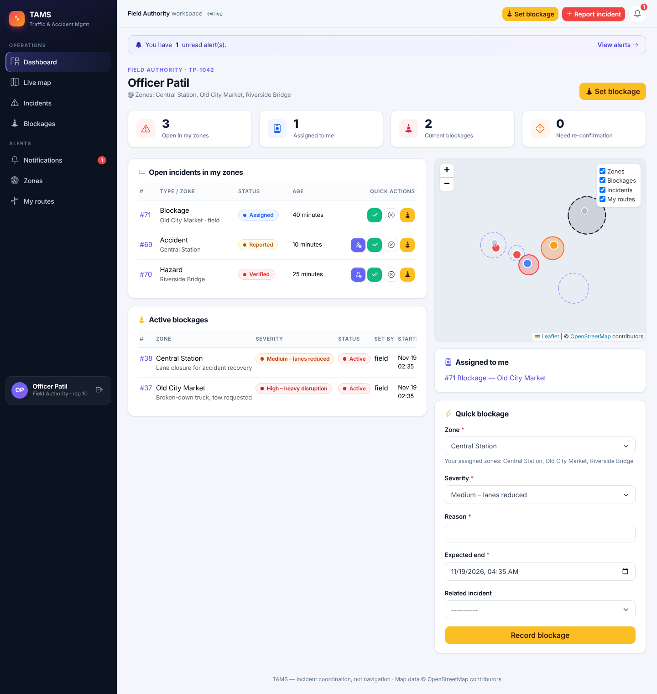

**Control room (Desk Admin)** — counts by status, map, dispatch queue, zone load, audit trail, users
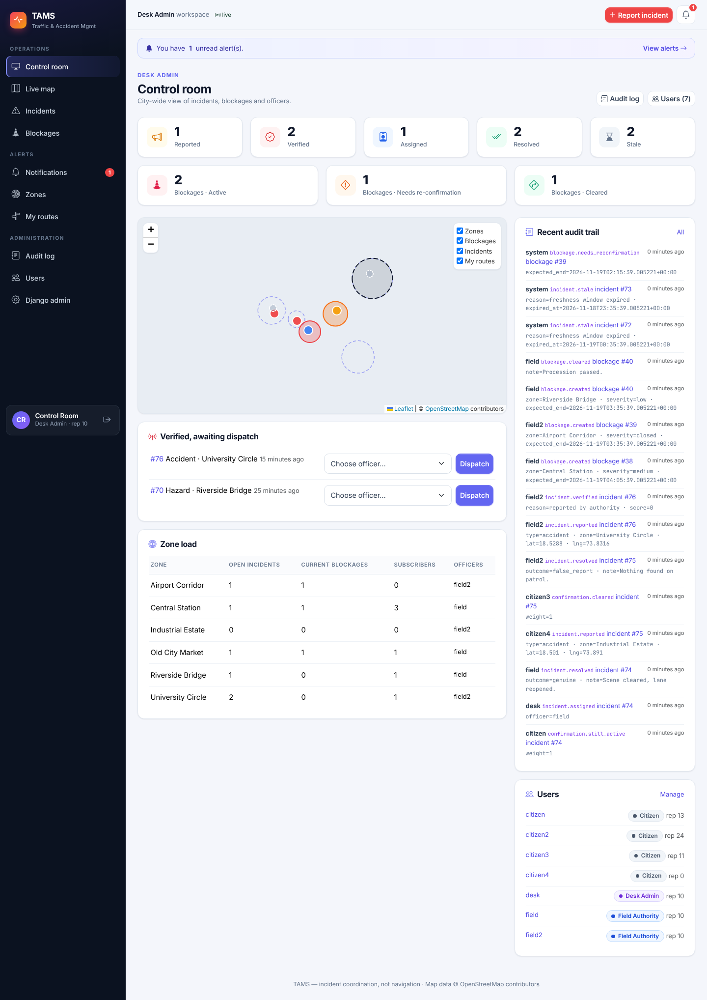

**Operational map**
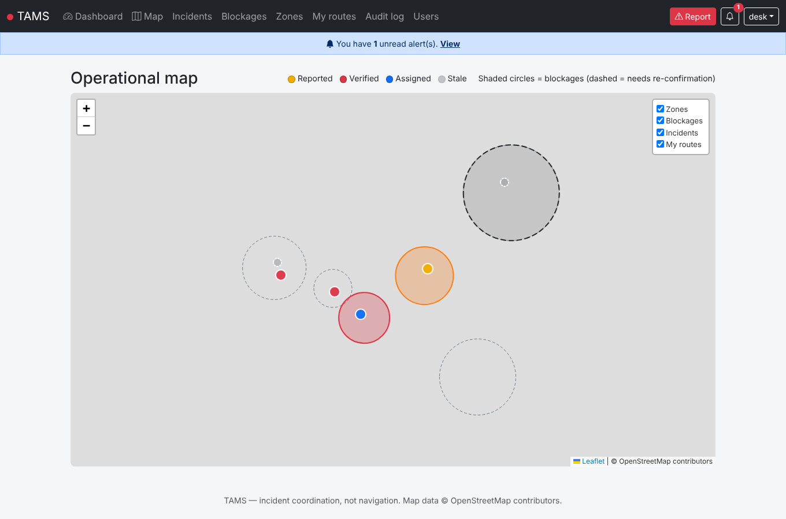

**Audit log**
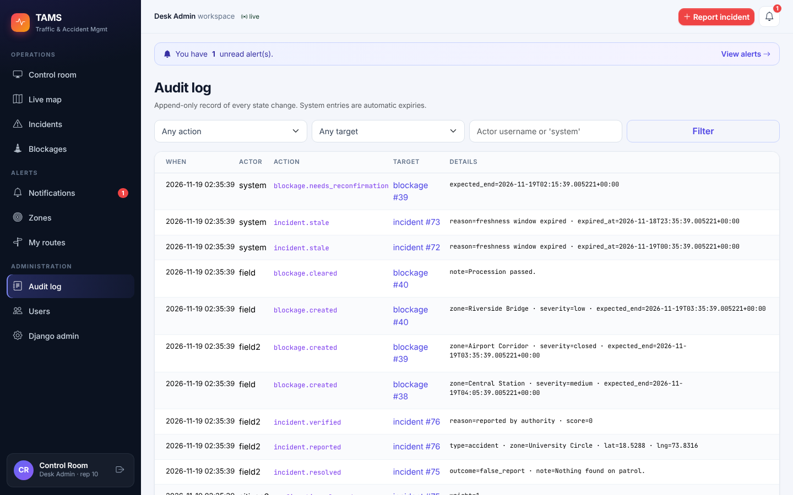

**Notifications**
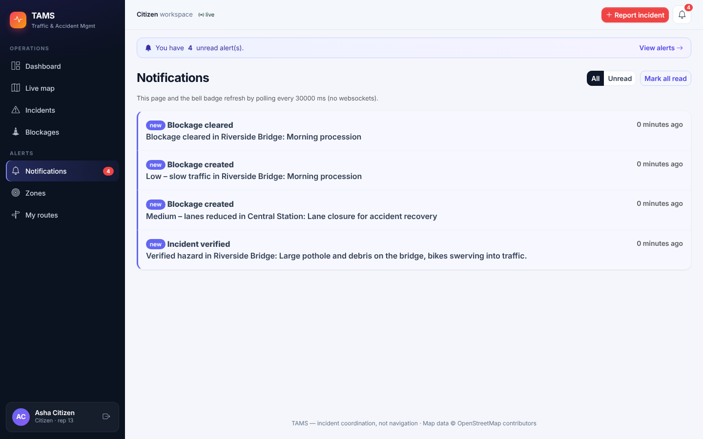

**Mobile view**
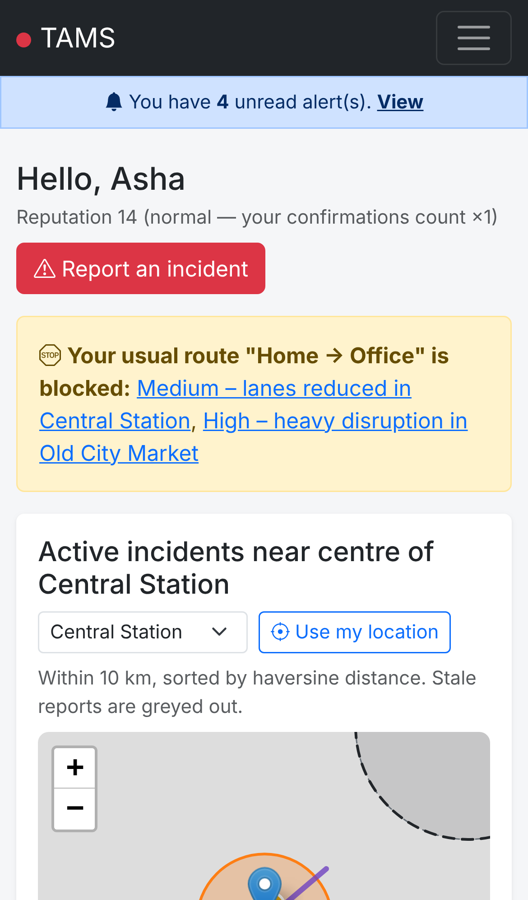

### 11.1 Outcome
All the objectives in Section 3.2 were met. Seeding the demo data produces a realistic dataset straight away (6 zones, 7 users, 8 incidents in every status, 4 blockages, confirmations, notifications and a full audit trail), so the whole workflow can be demonstrated in under two minutes.

---

## 12. Limitations and Future Scope

### 12.1 Limitations
- Zones are circles, and a blockage covers a whole zone rather than an exact road segment.
- Notifications arrive by polling, with up to 30 seconds of delay; there is no push or email delivery.
- The expiry check is triggered by web requests unless cron is configured, so a stored status can lag by up to a minute (the UI computes freshness live).
- Nearby search computes the exact distance in Python, which is fine at city scale; very large datasets would need PostGIS.
- The map tiles and CSS libraries come from CDNs, so the UI needs internet access.

### 12.2 Future Scope
1. **Celery or cron** scheduling for expiry, with a shared Redis cache.
2. **KPI analytics:** clearance-time charts (reported → verified → resolved) using the existing timestamps.
3. **PostGIS** polygon zones and road-segment-level closures.
4. **Push notifications, email or SMS** delivered from the same `Notification` rows.
5. **Abuse controls:** rate limits, and mandatory photos for low-reputation users.
6. An **open-data feed** (WZDx format) of verified closures for navigation apps.
7. A **REST API** (Django REST Framework) for third-party and mobile clients.

---

## 13. Conclusion

TAMS shows that a focused Django application can provide the coordination layer that consumer navigation apps leave out: structured reporting, community verification that keeps information fresh, accountable officer workflows, audited road closures and targeted alerts.

The project uses the core features of Django end to end:
- the MVT architecture;
- URL routing, including regular expressions;
- function-based and class-based views;
- the template language with inheritance and custom tags;
- forms with validation and CSRF protection;
- models, migrations and the ORM with foreign keys;
- a customised admin;
- groups and permissions;
- sessions and cookies;
- a custom user model with authentication;
- a 54-test automated suite.

Design decisions such as the services layer, explicit state machines, reputation-weighted votes, and polling instead of WebSockets were made deliberately and are documented in `NOTES.md`. The result is a system that is simple to run, easy to extend, and grounded in established traffic-incident-management practice.

---

## 14. References

1. Django Software Foundation. *Django 5.1 Documentation.* https://docs.djangoproject.com/en/5.1/
2. U.S. Federal Highway Administration. *Best Practices in Traffic Incident Management* (FHWA-HOP-10-050). https://ops.fhwa.dot.gov/publications/fhwahop10050/
3. U.S. Federal Highway Administration. *Traffic Incident Management Performance Measures.* https://ops.fhwa.dot.gov/tim/preparedness/tim/performance_measures.htm
4. Waze / Google. *Waze for Cities Data Feed — partner documentation.* https://support.google.com/waze/partners/answer/10618035
5. OpenStreetMap Foundation. *Tile Usage Policy.* https://operations.osmfoundation.org/policies/tiles/
6. Leaflet. *Leaflet 1.9 API Reference.* https://leafletjs.com/reference.html
7. Bootstrap. *Bootstrap 5.3 Documentation.* https://getbootstrap.com/docs/5.3/
8. Sinnott, R. W. (1984). "Virtues of the Haversine." *Sky and Telescope*, 68(2), 159.
9. OWASP Foundation. *Cross-Site Request Forgery (CSRF).* https://owasp.org/www-community/attacks/csrf

---

## Appendix A — Installation Guide
```bash
git clone https://github.com/ri5u/traffic_accident_management.git
cd traffic_accident_management
python -m venv venv
source venv/bin/activate            # Windows: venv\Scripts\activate
pip install -r requirements.txt
python manage.py migrate
python manage.py seed               # demo data (use --flush to reset)
python manage.py runserver          # open http://127.0.0.1:8000/
python manage.py test               # 54 tests
```

## Appendix B — Demo Credentials
All demo users share the password **`demo12345`**.

| Username | Role | Notes |
|---|---|---|
| citizen | Citizen | Subscribed to 2 zones; has a saved route |
| citizen2 | Citizen | Trusted (reputation ≥ 20) → votes count ×2 |
| citizen3 | Citizen | |
| citizen4 | Citizen | Low reputation → votes count ×0 |
| field | Field Authority | Central Station, Old City Market, Riverside Bridge |
| field2 | Field Authority | University Circle, Airport Corridor, Industrial Estate |
| desk | Desk Admin | Control room; also a Django superuser |
